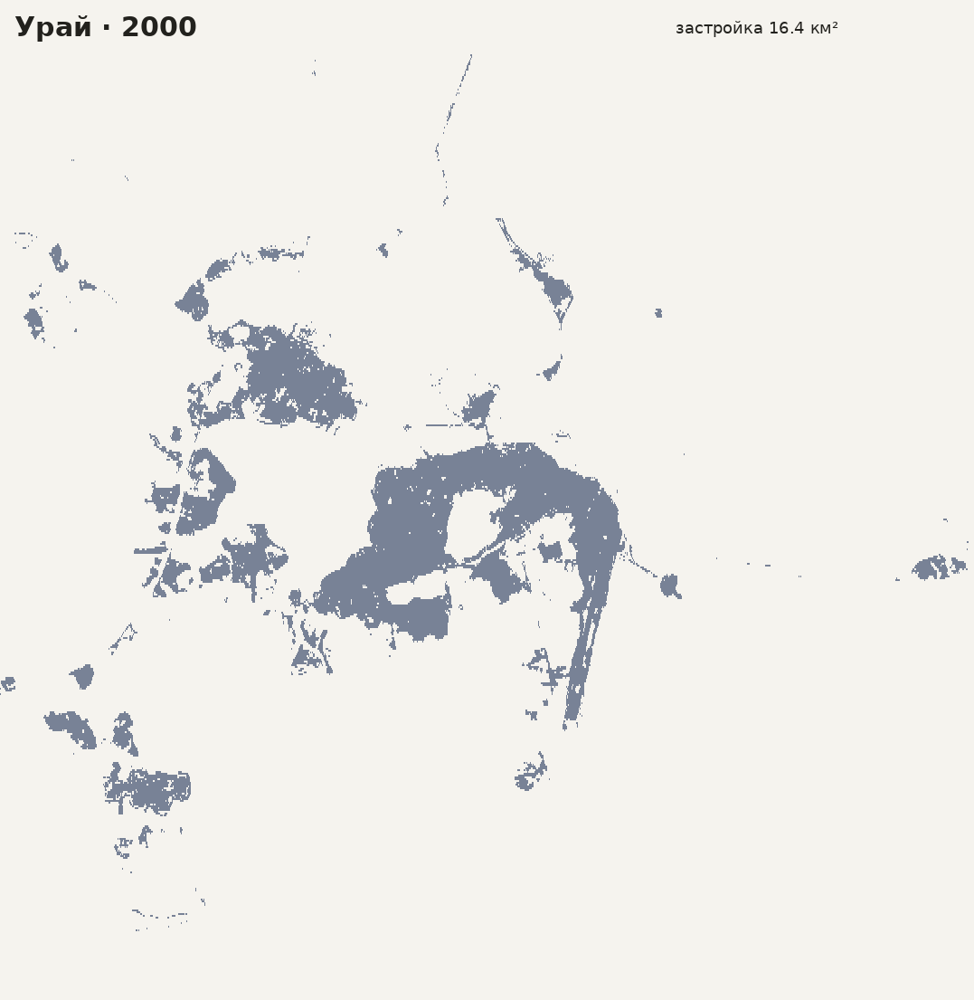

# Urban Auto – модуль QGIS для карт роста городов

Как рос город за последние 25 лет? Urban Auto отвечает на этот вопрос по снимкам Landsat 2000–2025 гг. и не требует
ручных обучающих точек. Модуль сам скачивает снимки, сам собирает метки из открытых глобальных продуктов
и в итоге выдаёт год появления застройки для каждого пикселя.
*Annual built-up maps and urban growth from Landsat in QGIS, without manual training points – English below.*

Модуль вырос из выпускной работы о геоэкологии г. Урай (ХМАО – Югра). Там он прошёл самую строгую проверку:
220 точек, дважды размеченных вслепую. Для карты 2025 г. получилась каппа 0,89. На других городах результаты
скромнее, и об этом честно написано в [описании модуля](urbanauto/README.md#точность-что-известно).

## Установка

1. Скачайте `urbanauto-5.5.1.zip` со страницы [Releases](https://github.com/76458436a-lgtm/urbanauto/releases/latest).
2. В QGIS 3.34 LTR или новее откройте **Модули → Управление и установка → Установить из ZIP**.
3. Модулю нужны `scikit-learn`, `scipy` и `requests`. Если чего-то не хватает, он сам подскажет команду установки
   (Windows: OSGeo4W Shell → `python -m pip install scikit-learn scipy requests`).

Как работать с модулем, что он выдаёт и где ошибается – в [urbanauto/README.md](urbanauto/README.md).

## Что внутри

| Папка | Содержание |
|---|---|
| `urbanauto/` | исходный код модуля (устанавливается в QGIS как есть) |
| `urbanauto/tests/` | автоматические тесты (unittest; часть требует QGIS) |
| `blind_check/` | протокол слепой проверки точности на новых городах |
| `media/` | иллюстрации |

## Как цитировать

Каленов Р.В. Urban Auto: модуль QGIS для картографирования роста застройки по данным Landsat. Версия 5.5.1. 2026.
URL: https://github.com/76458436a-lgtm/urbanauto

## Ошибки и предложения

Если модуль повёл себя странно на вашем городе, откройте [issue](https://github.com/76458436a-lgtm/urbanauto/issues)
и приложите `report.html` и `rf_series_protocol.json` из папки результатов. По ним обычно видно, что пошло не так.

## Лицензия

GPL-2.0-or-later, см. [LICENSE](LICENSE). Данные, которые скачивает модуль (Landsat, GHSL, WSF, ESA WorldCover,
JRC GSW, OpenStreetMap, Microsoft Building Footprints), распространяются по своим лицензиям. Их перечень
приводится в отчёте каждого расчёта.

---

## English

How has a town grown over the last 25 years? **Urban Auto** is a QGIS plugin that answers this from Landsat imagery
for 2000–2025 without any manual training points. Given a city name or a polygon, it downloads summer Landsat composites,
derives training labels from open products (GHSL, WSF, ESA WorldCover, JRC GSW, OSM and Microsoft buildings),
trains a gradient boosting model and detects the year built-up land first appeared. The output includes rasters,
GeoPackages, a CSV series and an HTML report with data attribution.

The plugin grew out of a thesis on the geoecology of Uray, Western Siberia, where a twice-blind check on 220 points gave
kappa 0.89 for 2025. Results elsewhere are more modest; see [urbanauto/README.md](urbanauto/README.md#english).

Install: download `urbanauto-5.5.1.zip` from [Releases](https://github.com/76458436a-lgtm/urbanauto/releases/latest),
then go to *Plugins → Manage and Install Plugins → Install from ZIP* (QGIS ≥ 3.34, with `scikit-learn scipy requests`).
License: GPL-2.0-or-later.
